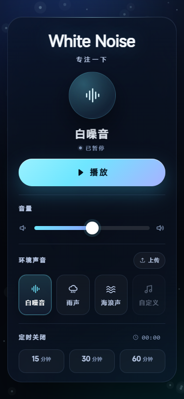
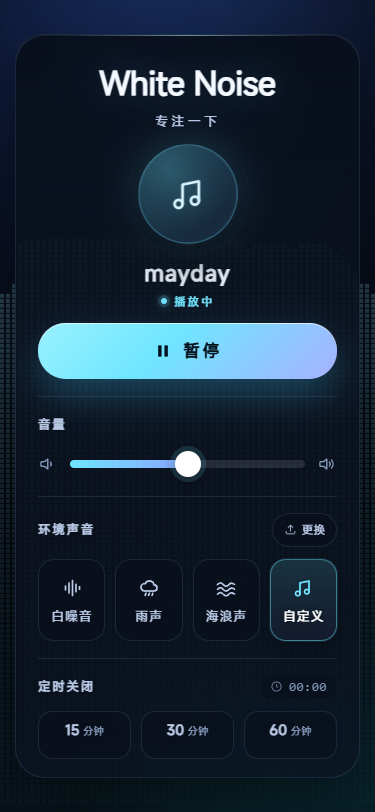
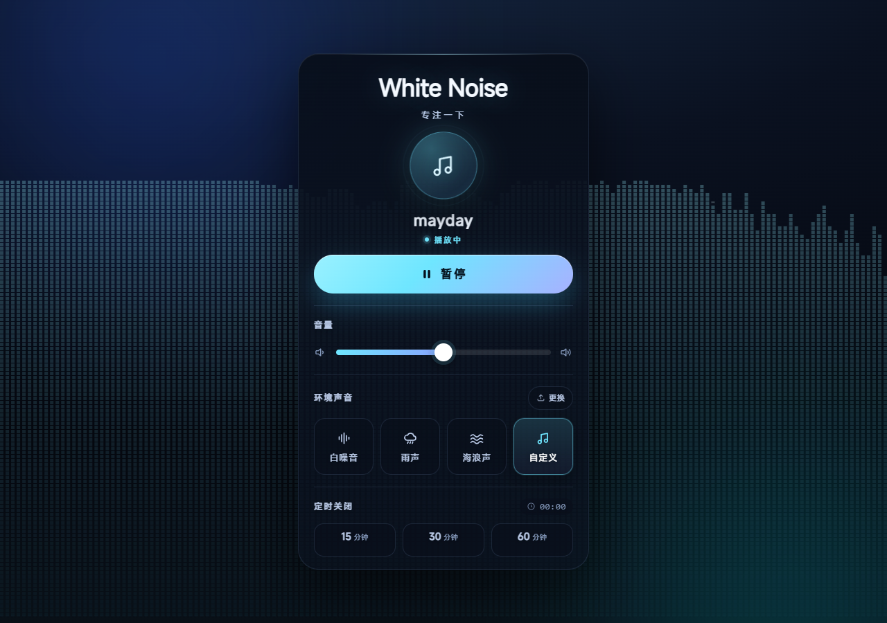
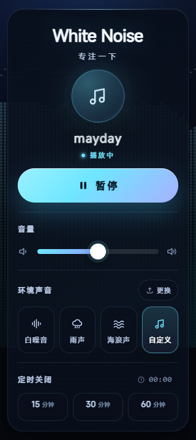

# WhiteNoise 白噪音专注助手 设计报告

| 项目 | 内容 |
| --- | --- |
| 项目名称 | WhiteNoise 白噪音专注助手 |
| 课程 | 移动端网页应用开发 |
| 完成日期 | 2026-10-26 |
| 版本 | V1.2|

## 目录

1. 项目背景与目标
2. 需求分析
3. 总体设计
4. 详细设计
5. 关键算法与实现细节
6. 测试与验收
7. 难点与解决方案
8. 不足与改进方向
9. 总结

## 摘要

WhiteNoise 是一个面向手机端的单页白噪音应用。它在不使用后端、数据库和用户登录的前提下，提供白噪音、雨声、海浪声三种环境声音，支持播放 / 暂停、音量调节和 15 / 30 / 60 分钟定时关闭。项目在基础需求之上增加了动态 canvas 背景、结束前 30 秒淡出、锁屏控制、声音与音量记忆、本地音频上传，以及随音频实时变化的像素柱可视化。

实现采用原生 HTML5 / CSS3 / JavaScript 与 Vue 3 全局构建版本，页面可以直接双击 `index.html` 打开，不需要构建步骤。音频侧使用两个 `<audio>` 元素：内置声音走元素音量，自定义音频走 Web Audio 的 `GainNode` 与 `AnalyserNode`，避免 `file://` 下媒体元素接入 Web Audio 后出现静音或分析数据为空。界面在 320 / 375 / 414 三种手机宽度下完成适配，Chrome 无头环境下的验收测试为 0 项 axe 违规。

---

## 1 项目背景与目标

### 1.1 项目背景

学习、阅读、写作和休息时，持续的环境声音可以帮助掩盖键盘、交通等突发噪声。手机端白噪音应用需要在较小的屏幕上完成声音选择、播放控制、音量调节和定时关闭，同时保持操作路径短、状态清楚。

本项目来自移动端网页开发课程设计，要求在约四周内完成一个不依赖后端的 V1.0 单页应用。实际实现在此基础上继续扩展，形成可用于课程展示的 V1.2 版本。

### 1.2 项目目标

1. 完成三种环境声音的选择、播放、暂停和切换。
2. 提供 0–100 的音量控制，并在内置声音与自定义音频之间保持一致。
3. 提供 15 / 30 / 60 分钟定时关闭，支持取消、结束前淡出和到点停止。
4. 适配手机竖屏，不出现横向滚动，按钮和文字适合触控。
5. 在基础功能之外，增加动态背景、锁屏控制、本地音频上传和实时音频可视化。
6. 保持纯静态、可离线运行，不引入后端和构建工具。

### 1.3 范围与约束

- 单页面，只有首页，不做个人中心、登录、社区、统计页。
- 声音来自本地音频文件，不实现实时白噪音生成算法。
- 自定义音频限制为小于 10MB；文件只在当前页面会话有效，不上传服务器。
- 不使用后端、数据库、登录和网络请求。
- 以手机竖屏为主，同时保证桌面浏览器可正常查看。
- 需要兼容 `file://` 直接打开的场景，不能依赖本地服务器。

---

## 2 需求分析

### 2.1 用户场景

| 场景 | 用户行为 | 设计关注点 |
| --- | --- | --- |
| 学习 / 阅读 | 打开页面，选择雨声或白噪音，播放并设置 30 分钟 | 首屏操作少，定时状态明显 |
| 午休 | 选择海浪声，设置 15 分钟，结束后自动停止 | 到点停止、音量不突变 |
| 专注写作 | 调整音量到较低水平，使用锁屏控制暂停 | 锁屏状态与页面状态同步 |
| 使用自己的音频 | 上传一首本地音乐或环境录音，听实时频谱 | 格式校验、解析失败提示、可视化反馈 |
| 中途切换 | 播放中切换到另一种声音，或刷新页面 | 不叠加播放、记住偏好、自定义文件回退 |

### 2.2 功能需求

| 编号 | 功能 | 需求说明 | 实现状态 |
| --- | --- | --- | --- |
| F1 | 声音选择 | 白噪音、雨声、海浪声三种内置声音，点击切换 | 完成 |
| F2 | 播放 / 暂停 | 同一时刻只播放一个声音，按钮状态同步 | 完成 |
| F3 | 音量 | 0–100 滑动条；内置声音和自定义音频都生效 | 完成 |
| F4 | 定时关闭 | 15 / 30 / 60 分钟；未播放时选中只预设，播放后开始计时 | 完成 |
| F5 | 到点停止 | 倒计时归零后停止播放、复位档位与按钮 | 完成 |
| F6 | 结束前淡出 | 最后 30 秒平滑降低音量，暂停 / 切换 / 取消定时恢复 | 完成 |
| F7 | 自定义音频 | 上传小于 10MB 的音频，自动选中并播放 | 完成 |
| F8 | 解析失败提示 | 无法解析的文件弹出明确对话框 | 完成 |
| F9 | 动态背景 | 三种内置场景 + 自定义音频的像素柱可视化 | 完成 |
| F10 | 锁屏控制 | Media Session 元数据、播放 / 暂停 / 停止 | 完成 |
| F11 | 偏好记忆 | 记住上次声音和音量，刷新后恢复但不自动播放 | 完成 |
| F12 | 响应式与无障碍 | 320 / 375 / 414 适配，键盘可达，减少动态效果 | 完成 |

### 2.3 非功能需求

- **可用性**：首屏即可操作，不需要滚动才能找到播放按钮；按钮高度不低于 44px。
- **一致性**：切换声音、暂停、定时结束等状态变化在同一处复位，避免按钮与真实播放状态不一致。
- **性能**：背景动画按屏幕像素比绘制，限制 DPR 上限；页面切到后台暂停绘制；定时器只在需要时存在。
- **可移植性**：所有依赖放在本地，断网可用；不依赖 Node、打包器或后端。
- **隐私**：自定义音频通过 `URL.createObjectURL` 在本地播放，不发起上传请求；`localStorage` 只保存声音和音量。
- **无障碍**：语义化结构、可见焦点、`aria-label` / `aria-pressed`、`prefers-reduced-motion` 处理。

### 2.4 需求边界

明确不实现：用户系统、云端同步、音频库、社区、数据统计、实时音频生成、定时时长自定义、跨设备同步。

---

## 3 总体设计

### 3.1 技术选型

| 技术 | 用途 | 选择理由 |
| --- | --- | --- |
| HTML5 | 页面结构、`audio`、`canvas`、`dialog` | 原生能力足够，无额外依赖 |
| CSS3 | 深色玻璃卡片、响应式布局、动效 | 不引入 UI 框架，体积小，便于控制视觉 |
| JavaScript | 播放控制、计时、文件处理、Web Audio | 浏览器原生 API |
| Vue 3（全局构建版） | 数据绑定、事件、条件与列表渲染 | 课程要求；本地 `lib/vue.global.prod.js`，离线可用 |
| Canvas 2D | 背景场景与频谱可视化 | 轻量、移动端兼容好 |
| Web Audio API | 自定义音频增益与分析 | 支持 GainNode 音量和 AnalyserNode 频谱 |
| Media Session API | 锁屏 / 通知栏控制 | 手机端播放体验需要 |
| localStorage | 声音与音量记忆 | 无需后端，容量足够 |

项目不引入构建工具，Vue 使用 `vue.global.prod.js` 全局构建版本，模板直接写在 `index.html` 内，适合课程作业和静态部署。

### 3.2 总体架构

```text
index.html
├─ #app（Vue 挂载点）
│  ├─ 标题 / 当前声音 / 播放按钮
│  ├─ 音量、环境声音、定时关闭
│  ├─ <audio ref="audio">        内置声音，使用元素音量
│  └─ <audio ref="customAudio">  自定义音频，接入 Web Audio
├─ <canvas class="bg-canvas">    全屏背景动画
└─ <dialog id="audio-error-dialog"> 解析失败提示

css/style.css    视觉、布局、响应式、无障碍样式
js/app.js        Vue 状态、播放控制、计时、上传、Media Session、持久化
js/scene.js      canvas 场景引擎（white / rain / ocean / custom）
lib/vue.global.prod.js  Vue 3 运行时
audio/           内置音频文件
```

数据流可以概括为：

```text
用户操作
  → Vue 事件 / 状态更新
  → 选择音源、设置音量或定时
  → <audio> 播放
       ├─ 内置声音：元素 volume
       └─ 自定义音频：MediaElementSource → GainNode → AnalyserNode → 扬声器
  → AnalyserNode 频谱 → scene.js → canvas
```

### 3.3 目录结构

```text
whitenoise/
├─ index.html
├─ css/style.css
├─ js/app.js
├─ js/scene.js
├─ lib/vue.global.prod.js
├─ audio/
│  ├─ white.wav
│  ├─ rain.wav
│  └─ ocean.wav
├─ images/icon.svg
├─ docs/
│  ├─ 需求分析.md
│  ├─ 验收测试记录.md
│  ├─ 设计报告.md
│  └─ report-assets/
└─ README.md
```

`audio/` 下的文件可以按同名替换为正式素材；当前项目不包含音频生成脚本。

### 3.4 状态与数据设计

Vue 的 `data` 保存页面级状态，音频节点、计时器、对象 URL 等不需要响应式的内容放在模块作用域：

| 名称 | 位置 | 作用 |
| --- | --- | --- |
| `isPlaying` | Vue data | 播放按钮状态 |
| `currentSound` | Vue data | 当前声音 id（white / rain / ocean / custom） |
| `volume` | Vue data | 0–100 音量 |
| `timer` | Vue data | 当前剩余秒数，用于显示 |
| `timerPreset` | Vue data | 选中的定时档位（分钟） |
| `timerRunning` | Vue data | 倒计时是否已经启动 |
| `audioStarted` | Vue data | 音频是否真正开始播放过 |
| `customReady` | Vue data | 是否已上传可用的自定义音频 |
| `customName` / `customFileName` | Vue data | 自定义音频显示名与原始文件名 |
| `errorMsg` | Vue data | 页面内错误提示（尺寸 / 类型等） |
| `mainAudio` / `customAudio` | 模块变量 | 两个 audio 元素 |
| `audioCtx` / `gainNode` / `analyserNode` | 模块变量 | 自定义音频的 Web Audio 图 |
| `customUrl` | 模块变量 | 当前自定义音频的 blob URL |
| `timerEndAt` | 模块变量 | 定时结束的真实时间戳 |
| `fadeFactor` | 模块变量 | 结束前淡出的系数 |

`isPlaying` 与 `audioStarted` 分开：前者表示按钮显示状态，后者表示音频是否已经真正开始播放。暂停会清除定时，所以不能只靠 `isPlaying` 判断倒计时是否开始。

### 3.5 开发过程与进度

| 阶段 | 主要工作 | 产出 |
| --- | --- | --- |
| 第 1 周 | 需求分析、页面草图、HTML/CSS 静态页 | 可显示的移动端页面 |
| 第 2 周 | Vue 数据、声音选择、播放 / 暂停、状态同步 | 可交互的三声音播放器 |
| 第 3 周 | 音量换算、单一定时器、倒计时与到点停止 | 完整基础功能 |
| 第 4 周 | 多宽度测试、异常场景、UI 收尾 | V1.0 |
| 拓展 | 动态背景、淡出、Media Session、偏好记忆 | V1.1 |
| 拓展 | 本地音频上传、解析失败弹窗、像素柱可视化 | V1.2 |

---

## 4 详细设计

### 4.1 页面与视觉

页面采用深色夜间专注风格：深蓝黑背景、半透明玻璃卡片、青色强调色。首屏从上到下为标题、当前声音与图标、播放按钮、音量、环境声音、定时关闭。375×812 下完整一屏显示；320×568 下允许纵向滚动。

自定义音频模式下，卡片背景改为从顶部到底部逐渐变透明的线性渐变，并关闭 `backdrop-filter` 的大半径模糊，让像素柱可以透过卡片看到；声音卡片、定时按钮、上传按钮等增加暗色底，避免文字直接压在像素网格上。



*图 1　初始页面：三种内置声音与未上传的自定义卡片*

### 4.2 声音模型与播放

内置声音由 `SOUNDS` 数组定义：

```js
const SOUNDS = [
  { id: 'white', name: '白噪音', file: 'audio/white.wav' },
  { id: 'rain',  name: '雨声',   file: 'audio/rain.wav' },
  { id: 'ocean', name: '海浪声', file: 'audio/ocean.wav' },
  { id: 'custom', name: '自定义', file: '' }
];
```

选择声音时先停止当前元素，再替换音源并复位按钮；播放使用 `audio.play()` 的 Promise，成功后才把 `isPlaying` 设为 `true`。暂停会同时暂停两个元素、清除定时和淡出，确保不会出现“按钮显示暂停但声音还在播放”的状态。

选中的第四个卡片在未上传文件时禁用，上传成功后启用并自动选中。内置音频与自定义音频共用同一套播放 / 暂停逻辑，但音源和音量链路不同。

### 4.3 双 audio 与 Web Audio 链路

这是本项目最关键的架构决定。最初尝试把三种内置声音直接接到 `createMediaElementSource`，在 `file://` 下出现 Web Audio 输出静音、AnalyserNode 数据恒为 0 的问题；原因是本地媒体文件的 CORS 状态会使媒体元素接入 Web Audio 后无法正常输出。最终采用两条独立链路：

```text
内置声音：
  <audio ref="audio"> → 元素 volume → 扬声器

自定义音频：
  <audio ref="customAudio">（volume = 1）
    → MediaElementSource
    → GainNode（音量与淡出）
    → AnalyserNode（fftSize 2048，smoothing 0.8）
    → destination
```

这样内置声音保持原生、稳定，自定义音频（blob URL，同源）可以安全接入 Web Audio，并且 `AnalyserNode` 放在 `GainNode` 之后，频谱会随实际输出音量变化。

`ensureAudioGraph()` 只在自定义音频第一次播放时创建音频上下文和节点；创建失败时设置 `audioGraphFailed` 并回退到元素音量。自定义音频的 `audio.volume` 固定为 1，音量由 `GainNode.gain` 控制。

### 4.4 音量与结束前淡出

`applyOutputVolume()` 同时处理两条链路：

```text
输出音量 = clamp(volume, 0, 100) / 100 × fadeFactor
```

- 内置声音：写入 `mainAudio.volume`。
- 自定义音频：写入 `gainNode.gain`；如果音频图未建立，则回退到 `customAudio.volume`。
- 淡出：`fadeFactor` 从 1 线性降到 0，每 100ms 更新一次。

定时最后 30 秒启动淡出，使用 `timerEndAt - Date.now()` 计算剩余秒数，因此淡出进度不依赖 interval 的累计次数。暂停、切换声音或取消定时会调用 `stopFade()`，把 `fadeFactor` 恢复为 1。

### 4.5 定时关闭

定时器有四个状态：

| 状态 | `timerPreset` | `timer` | `timerRunning` | `audioStarted` | 行为 |
| --- | --- | --- | --- | --- | --- |
| idle | 0 | 0 | false | 任意 | 不显示倒计时 |
| armed | 15 / 30 / 60 | 档位秒数 | false | false | 显示整段时长，不递减 |
| running | 档位 | 递减 | true | true | 每秒减 1，最后 30 秒淡出 |
| finished | 0 | 0 | false | false | 停止播放、复位界面 |

关键代码：

```js
startTimer(minutes) {
  if (this.timerPreset === minutes && this.timer > 0) {
    this.clearTimer();
    return;
  }
  this.clearTimer();
  this.timerPreset = minutes;
  this.timer = minutes * 60;
  this.timerRunning = false;
  // 播放中选档位立即开始；暂停时只预设定时
  if (this.audioStarted) this.beginCountdown();
}
```

暂停时选 15 分钟，页面显示 15:00 并保持不动；再点播放，`onPlayStarted()` 发现已有预设但尚未运行，才调用 `beginCountdown()`。这解决了“选档位就开始计时、播放前已经少了几秒”的问题。暂停本身会清除定时，符合“暂停后重播需重新选档位”的需求。

播放中切换声音不会重置倒计时：`selectSound()` 停止声音并复位按钮，但不调用 `clearTimer()`。倒计时继续，到点后停止当前声音。

### 4.6 自定义音频上传

上传入口是“环境声音”右侧的按钮，隐藏的 `<input type="file" accept="audio/*">` 负责选择文件。流程：

1. `pickFile()` 清空 input 的 value，保证再次选择同一个文件也能触发 `change`。
2. `handleCustomFile()` 校验：非空、`size < 10 × 1024 × 1024`、MIME 以 `audio/` 开头或扩展名匹配常见音频格式。
3. 通过 `URL.createObjectURL(file)` 生成会话内 URL，替换旧对象 URL 并释放旧 URL。
4. 更新卡片名称、启用自定义卡片，停止当前播放并自动选中自定义。
5. 设置 `customAudio.src` 并加载；用户点播放后建立 Web Audio 图。

自定义文件名去掉扩展名后显示在播放区，卡片标题仍为“自定义”。文件只保留在当前页面会话，刷新后自定义不可用并回退到白噪音，这是有意的隐私 / 简化设计。

**解析失败处理**：自定义音频的 `error` 事件或 `play()` 的 `NotSupportedError` 会触发 `showAudioErrorDialog()`，使用原生 `<dialog>` 弹出“音频无法解析”提示，点击“知道了”关闭；不支持 `dialog` 的浏览器退回 `window.alert()`。尺寸、空文件、非音频类型仍在页面内提示，不弹窗。


*图 2　无法解析的音频文件会弹出明确对话框*

### 4.7 动态背景与自定义可视化

`js/scene.js` 是一个独立的 canvas 场景引擎，提供 `setScene`、`setPlaying`、`setVolume`、`setAnalyser` 和 `destroy` 接口。内置场景有三种：

- **white**：缓慢漂浮的颗粒，带轻微的大小和透明度变化。
- **rain**：不同速度、长度的雨丝斜向下落。
- **ocean**：多层正弦波叠加的海浪。

切换声音时用 650ms 交叉淡化过渡。canvas 按 `devicePixelRatio` 缩放，DPR 上限为 2；resize 延后 150ms 执行，避免拖动窗口时频繁重建。页面切到后台时停止 `requestAnimationFrame`，回到前台恢复；系统开启 `prefers-reduced-motion` 时只绘制静态一帧。

自定义音频使用第四种场景：底部向上的像素柱。实现要点如下。

**（1）频段**

不直接线性覆盖整个 0–22kHz，而是取对数分布的 35Hz–12kHz：

```text
f_i = 35 × (12000 / 35)^(i / N)
```

每个柱子取频段内若干 FFT bin 的最大值，而不是平均值。高频段在音乐中能量通常更低，使用最大值能保留镲片、齿音等瞬态；再对右端做 1.5 倍高频补偿，使右端不会长期静止。100Hz + 10kHz 双音测试中，左右两端都能出现柱子。

**（2）高度压缩**

输入先归一化，并加 1.1 倍前置增益和高频补偿，然后进入软膝压缩：

```text
x ≤ 0.55：y = x
x > 0.55：t = (x - 0.55) / 0.45
          y = 0.55 + 0.35 × t / (1 + 0.8t)
```

- 0.55 以下保持线性，正常响度不被压扁。
- 曲线最高点在 x=1，y≈0.744；0.9 只是渐近上限，实际输入到 1 也到不了。
- 绘制时柱体与峰值块都限制在 `maxBlocks - 2`，顶部额外留 2 行。这样即使某个频段达到最大输入，任何像素也不会碰到当前设置的高度线。
- 没有直接使用 tanh / sigmoid，是因为这类激活函数会把中等响度整体抬高，和“正常响度不被妨碍”的目标不一致；软膝压缩是音频动态范围处理的常用做法。

**（3）像素与渐变**

- 柱子数量：`round(clamp(width / 6, 32, 160))`，375 宽约 63 根，1280 宽 160 根。
- 方块尺寸：4–5px，列间距手机 2px、桌面 3px，行间距 1px。
- 颜色：32 级调色板从底部深青 `rgb(22, 66, 86)` 渐变到顶部浅青 `rgb(150, 226, 238)`；透明度从底部的 0.13 增加到顶部的约 0.46。
- 峰值块单独绘制，缓慢回落；柱体上升快、下降慢，避免视觉上抖动过度。
- 柱子整体颜色比早期版本暗，卡片下半部分的控件增加暗底，保证文字可读。



*图 3　手机端：自定义音频的像素柱与竖向渐变*



*图 4　桌面端：更宽的频谱范围，左右两端都有响应*

### 4.8 锁屏控制

`setupMediaSession()` 在有 `navigator.mediaSession` 的环境下注册：

- `play`：调用播放；
- `pause`：调用暂停；
- `stop`：停止并复位；
- 元数据：标题使用 `currentSoundMeta.name`，自定义音频显示文件名；
- 封面：运行时用 canvas 生成 512×512 的 data URL，不额外增加图片文件；
- `playbackState` 随 `isPlaying` 同步为 `playing` / `paused`。

没有 Media Session 的环境会跳过，不影响页面内播放。

### 4.9 偏好记忆

使用 key `whitenoise:v1` 保存：

```json
{ "sound": "rain", "volume": 50 }
```

页面初始化时读取并恢复声音与音量，但不自动播放。自定义音频不会被恢复：刷新后 `customReady` 为 false，若存储中的声音是 custom，则回退到 white。`localStorage` 不可用（隐私模式、部分 `file://` 环境）时静默使用默认值。

### 4.10 无障碍与响应式

- 页面使用 `<main>`、`<header>`、`<section>` 等语义元素；声音卡片和定时档位使用 `aria-pressed` 表示选中状态。
- 播放按钮、上传按钮、文件输入都有可读标签；文件输入在视觉上隐藏但保留可访问性。
- 所有按钮使用 `:focus-visible` 焦点环，触控区域不小于 44px。
- 支持 `prefers-reduced-motion`：背景只绘制静态一帧。
- 320 / 375 / 414 三种宽度下 `scrollWidth` 等于视口宽度；375×812 全页 812px，320 下允许纵向滚动。
- 颜色对比度：axe 自动审计 0 项违规；由于渐变与毛玻璃背景，对比度有 20 个节点被标记为“需人工确认”，正文按配色值核算在 5:1 以上。



*图 5　320 宽度下无横向滚动，卡片与像素背景仍完整*

---

## 5 关键算法与实现细节

### 5.1 播放 / 暂停状态机

```text
idle
  ├─ 点击播放 → 加载音源 → play() 成功 → playing
  └─ 选择声音 → idle（停止当前声音，复位按钮）

playing
  ├─ 点击暂停 → idle（暂停两个元素、清除定时、恢复淡出）
  ├─ 选择声音 → idle（停止当前声音；若定时已运行则继续倒计时）
  └─ 定时归零 → idle（停止、清空档位、复位按钮）
```

`onPlayStarted()` 是进入 playing 的统一入口。它负责设置 `isPlaying`、`audioStarted`、同步 Media Session，并在有预设时启动倒计时。这样无论通过页面按钮还是锁屏 play 恢复，定时行为一致。

### 5.2 定时与淡出

- `startTimer(minutes)`：写入 `timerPreset` 和 `timer`；播放中立即 `beginCountdown()`，暂停时只预设。
- `beginCountdown()`：记录 `timerEndAt = Date.now() + timer × 1000`，启动 1s interval。
- `tick()`：每秒递减 `timer`；归零调用 `finishTimer()`。
- `finishTimer()`：暂停两个音频、复位按钮、清空档位、停止淡出。
- `startFade()`：每 100ms 用 `timerEndAt - Date.now()` 计算 `fadeFactor`，避免累计误差。
- 暂停、切换声音、取消档位：`clearTimer()` / `stopFade()` 恢复音量。

已知限制：页面切到后台时浏览器会节流 interval，倒计时显示可能变慢；淡出使用时间戳，但启动淡出的 `syncFade()` 仍依赖 tick 调用。桌面和前台使用不受影响。

### 5.3 频谱与高度映射

代码中的关键参数：

| 参数 | 值 | 说明 |
| --- | --- | --- |
| `fftSize` | 2048 | 1024 个频段 bin |
| `smoothingTimeConstant` | 0.8 | 分析器平滑 |
| 频率范围 | 35–12000 Hz | 对数分布 |
| 高频补偿 | 1 + 0.5t（最大 1.5） | 弥补音乐高频能量低 |
| 前置增益 | 1.1 | 统一输入电平 |
| 软膝阈值 | 0.55 | 以下线性 |
| 软膝渐近上限 | 0.9 | 实际最高约 0.744 |
| 顶部安全边距 | 2 行 | 柱体和峰值块都不触碰高度线 |
| 柱体上升 / 下降 | 16 / 6（1/s） | 上升快、下降慢 |
| 峰值回落 | 0.5 × maxBlocks / s | 缓慢回落 |

这个映射解决了三个问题：右端不再对应没有人声 / 乐器能量的 20kHz 空频段；高频在视觉上不会完全静止；大音量不会把整屏压成一面平墙。

---

## 6 测试与验收

### 6.1 测试环境

- Windows 11，Chrome 无头模式；
- 当前内置音频为 20 秒 WAV 占位素材（`white.wav` / `rain.wav` / `ocean.wav`）；早期功能验收在原始 MP3 素材上完成，播放路径与元素一致；
- 页面通过 `file://` 直接打开；
- 视口：320×568、375×812、414×896；
- 使用 agent-browser 操作 DOM、模拟上传、截图；
- axe-core 4.12.1 审计。

### 6.2 12 项验收标准

| 编号 | 验收标准 | 结果 | 依据 |
| --- | --- | --- | --- |
| 1 | 手机页面正常显示 | 通过 | 三种宽度无横向滚动 |
| 2 | 白噪音正常播放 | 通过 | `paused=false`，`currentTime` 递增 |
| 3 | 雨声正常播放 | 通过 | 切换后音源为 `audio/rain.wav` |
| 4 | 海浪声正常播放 | 通过 | 切换后音源为 `audio/ocean.wav` |
| 5 | 点击按钮开始播放 | 通过 | 播放后按钮变为“暂停” |
| 6 | 点击按钮暂停 | 通过 | 按钮回到“播放”，同时清空定时 |
| 7 | 三种声音切换 | 通过 | 选中态、名称、音源同步 |
| 8 | 音量调节 | 通过 | 内置 0/50/100 对应 volume 0/0.5/1；自定义走 GainNode |
| 9 | 定时档位 | 通过 | 15/30/60 分钟；暂停时只预设，播放后递减 |
| 10 | 到点自动停止 | 通过 | 归零后停止播放并复位界面 |
| 11 | 手机页面无明显错误 | 通过 | 320 下可纵向滚动，无溢出、无文字截断 |
| 12 | 连续操作稳定 | 通过 | 见 6.3 异常场景 |

### 6.3 异常场景

| 场景 | 结果 | 依据 |
| --- | --- | --- |
| 连续点击播放 3 次 | 通过 | 最终为播放态，同一时刻只有一个音频在播放 |
| 播放中切换声音 | 通过 | 旧声音立即停止，新音源就绪，按钮复位 |
| 暂停后重新播放 | 通过 | 播放正常，暂停时定时已清零 |
| 音量调到 0 | 通过 | 内置 `volume=0`；自定义 GainNode=0 |
| 连续切换不同声音 | 通过 | 没有多个声音叠加 |
| 倒计时结束 | 通过 | 加速跑完 15 分钟后真正停止并复位 |

### 6.4 定时启动行为

| 操作 | 结果 |
| --- | --- |
| 暂停时点击 15 分钟 | 显示 15:00，档位选中，1.2 秒后仍是 15:00 |
| 再点击播放 | 倒计时开始，1.2 秒后显示 14:59 |
| 播放中点击档位 | 从整段时长立即开始递减 |
| 未开始时再次点击当前档位 | 取消定时，回到 00:00 |
| 暂停 | 清除定时，回到 00:00 |

### 6.5 V1.1 / V1.2 拓展检查

| 项目 | 结果 | 依据 |
| --- | --- | --- |
| 动态背景 | 通过 | 三种内置场景绘制正常；切声音无报错 |
| 结束前淡出 | 通过 | 最后 30 秒音量平滑到 0；暂停 / 切换恢复 |
| 锁屏控制 | 通过 | 元数据随声音变化，playbackState 同步 |
| 记住上次状态 | 通过 | rain / 25 刷新后恢复，保持暂停 |
| 减少动态效果 | 通过 | 强制 reduced-motion 后两张截图哈希一致 |
| 自定义上传 | 通过 | 9.6MB 流行音乐上传、自动选中、播放正常 |
| 超过 10MB | 通过 | 11MB 文件被拒绝，提示“音频文件需要小于 10MB。” |
| 非音频文件 | 通过 | `.txt` 被拒绝 |
| 解析失败 | 通过 | 伪造 `.mp3` 弹出“音频无法解析”对话框，关闭后可重传 |
| 频率覆盖 | 通过 | 100Hz + 10kHz 双音左右两端都有柱子 |
| 实时可视化 | 通过 | 4–5px 方块、竖向渐变、列间距 2–3px；软膝压缩后任何响度不触碰高度线；音量 0 回到基线 |
| 四列布局 | 通过 | 320 / 375 / 414 无横向滚动；375 一屏 |

### 6.6 无障碍与视觉检查

- axe-core：0 项违规，1 项“需人工确认”（颜色对比度，20 个渐变 / 毛玻璃节点）。
- 键盘可到达播放、上传、声音、定时等控件；焦点环可见。
- 320 / 375 / 414 下按钮高度与卡片宽度符合触控要求。
- 背景动画在切到后台和 `prefers-reduced-motion` 下停止。
- 自定义音频模式下，卡片下半部分增加暗底，文字仍可读。

---

## 7 难点与解决方案

| 难点 | 现象 | 解决方案 |
| --- | --- | --- |
| `file://` 媒体接入 Web Audio 静音 | 内置声音通过 `MediaElementSource` 后无声，Analyser 数据全 0 | 两个 audio 元素；内置走元素音量，自定义才接 Web Audio |
| 元素音量不影响 Web Audio | 修改 `customAudio.volume` 对频谱 / 输出无效 | 自定义音量与淡出统一走 `GainNode.gain` |
| 暂停时选档位 | 原实现选档位立即倒计时，播放前已少几秒 | 引入 `audioStarted`；暂停时只预设，`onPlayStarted()` 后启动 |
| 右端频谱不动 | 线性映射覆盖到 20kHz，普通音乐几乎没有能量 | 35–12kHz 对数频段 + 频段最大值 + 高频补偿 |
| 大音量整屏一样高 | 频谱柱全部接近顶部，缺少层次 | 软膝压缩，0.55 以下线性，峰值压到约 0.744 |
| 柱体触碰高度线 | 峰值接近画布上限 | 软上限 0.9 + 柱体 / 峰值限制在 `maxBlocks - 2`，顶部留 2 行 |
| 像素块过大、过亮 | 早期 7px、亮青色，背景抢文字 | 4–5px 方块、2–3px 列间距、暗色调色板、控件暗底 |
| 解析失败只显示一行文字 | 用户容易忽略，状态不明确 | 原生 `<dialog>` 显式弹窗，按钮关闭，旧浏览器 fallback alert |
| 自定义卡片误选 | 未上传时点击自定义无反应 | 未上传时禁用卡片；上传成功后自动启用并选中 |
| 替换同一文件不触发 change | input value 未清空 | `pickFile()` / `onFileChange()` 清空 value |

---

## 8 不足与改进方向

1. **自定义音频不持久化**：刷新后需要重新上传。可改用 IndexedDB 保存 Blob，并在加载时恢复，但需要处理容量与清理策略。
2. **iOS 真机未验证**：内置声音的 `audio.volume` 在 iOS 上只读，自定义音频的 Web Audio、Media Session 行为也需要真机确认；当前只在 Chrome 桌面 / 无头环境验证。
3. **后台计时精度**：页面切到后台时 interval 会被节流，倒计时显示可能落后于真实时间。可以把 `timer` 改为每次由 `timerEndAt - Date.now()` 计算，减少后台节流带来的偏差。
4. **音频素材体积**：内置音频使用本地文件，体积较大时首次加载会占用带宽 / 内存；正式部署可以压缩音频码率或改为流式加载。
5. **可视化性能**：桌面 160 根柱子 × 多行方块，绘制量较大；低端机可减少柱数或降低 DPR 上限，加入帧率自适应。
6. **功能边界**：不支持自定义定时时长、音频列表、播放进度、后台播放队列；这些属于后续版本范围。
7. **自动化测试**：当前以浏览器脚本和人工截图为主，后续可以把 12 项验收和异常场景固化为 Playwright 测试。

---

## 9 总结

WhiteNoise 在 V1.0 的三声音、播放控制、音量和定时关闭基础上，完成了 V1.1 的动态背景、淡出、锁屏控制和偏好记忆，以及 V1.2 的本地音频上传、解析失败弹窗和实时像素柱可视化。

项目的核心不只是页面展示，而是几个容易被忽略的边界：`file://` 下 Web Audio 的 CORS 静音、元素音量与 GainNode 的分工、暂停时定时不应启动、右端频谱的能量分布、以及大音量下可视化高度不能触碰边界。通过双 audio 架构、`audioStarted` 状态、对数频段、软膝压缩和顶部安全边距，这些问题在实现和测试中都得到了明确处理。

最终页面保持纯静态、可离线运行，320 / 375 / 414 适配完成，axe 自动审计 0 项违规，12 项验收标准和主要异常场景全部通过。

---